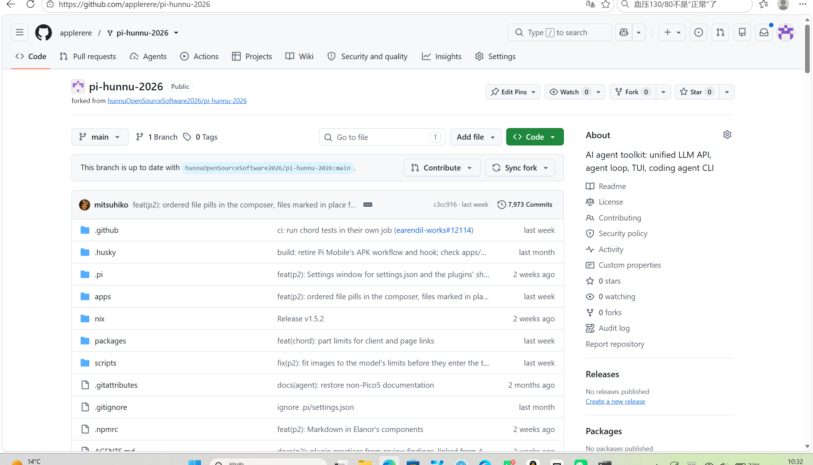
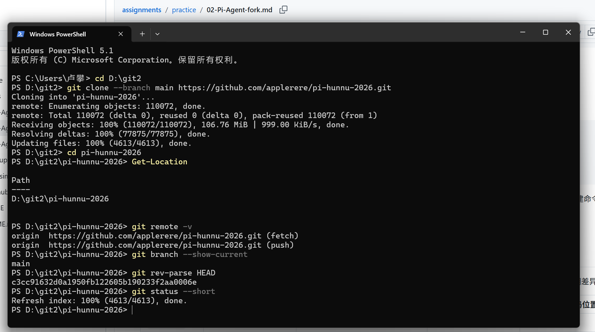
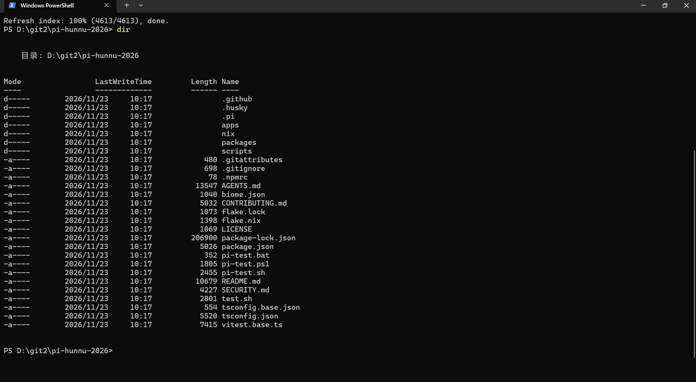
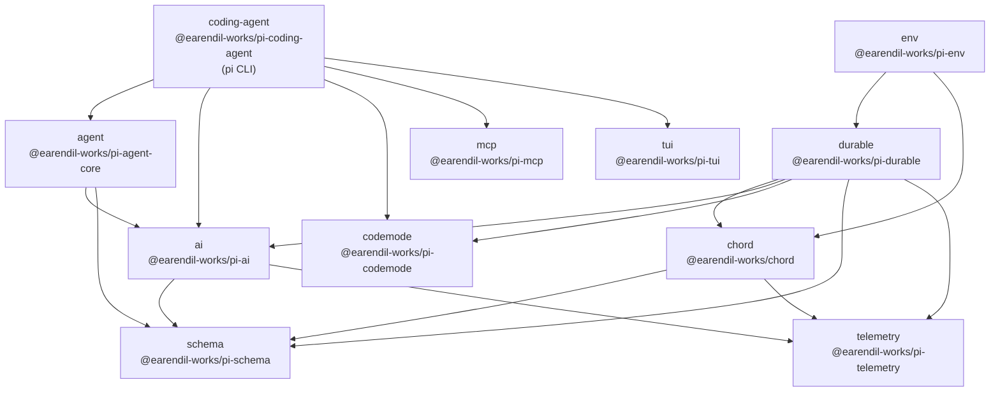

# 实践课 2：组织建仓与源码分析报告

- **姓名**：卢攀
- **姓名拼音**：lupan
- **小组代码仓库**：https://github.com/applerere/pi-hunnu-2026
- **本人实际 clone 地址**：https://github.com/applerere/pi-hunnu-2026.git
- **clone 后本地路径**：`D:\git2\pi-hunnu-2026`
- **当前分支**：`main`
- **完整提交编号（HEAD）**：`c3cc91632d0a1950fb122605b190233f2aa0006e`
- **本人重点分析的模块**：ai、agent、coding-agent

---

## 一、源码获取

### 1.1 小组组织仓库

组长已将课程仓库 fork 到小组组织，仓库地址为：
https://github.com/applerere/pi-hunnu-2026



### 1.2 本地 clone 与仓库信息确认（截图 S1）

在全英文路径下执行 clone：

```powershell
cd D:\git2
git clone --branch main https://github.com/applerere/pi-hunnu-2026.git
cd pi-hunnu-2026
```

随后在仓库根目录执行以下命令确认源码来源与版本：

```powershell
Get-Location
git remote -v
git branch --show-current
git rev-parse HEAD
git status --short
```

确认结果：

| 检查项 | 结果 |
|---|---|
| 当前目录 | `D:\git2\pi-hunnu-2026` |
| 远端 origin | `https://github.com/applerere/pi-hunnu-2026.git`（fetch / push） |
| 当前分支 | `main` |
| 工作区状态 | 干净（`git status --short` 无输出） |
| 提交编号 | `c3cc91632d0a1950fb122605b190233f2aa0006e` |

> 

### 1.3 源码目录截图

clone 完成后的仓库根目录结构如下（能看到 `packages`、`apps`、`package.json` 等关键文件）：


> 

---

## 二、模块分析

### 2.1 构建顺序

根目录 `package.json` 的 `build` 脚本（[package.json](https://github.com/applerere/pi-hunnu-2026/blob/main/package.json) 中 `scripts.build` 字段）按以下顺序依次进入各模块执行 `npm run build`：

```
telemetry → schema → chord → tui → codemode → mcp → ai → durable → env → agent → coding-agent
```


### 2.2 模块分析表

| 子文件夹 | 代码主要实现什么功能 | 本模块 build 执行什么、生成什么 | 直接依赖哪些内部模块 | 依据文件或代码位置 |
|---|---|---|---|---|
| `telemetry` | 厂商中立的遥测契约与类型化 schema 工具（tracing / 可观测性） | 执行 `tsc -p tsconfig.build.json`，把 `src/` 编译为 `dist/`（含 `index.js`、`render.js`、`testing/` 及对应 `.d.ts`） | 无 | [packages/telemetry/package.json](https://github.com/applerere/pi-hunnu-2026/blob/main/packages/telemetry/package.json) |
| `schema` | 不使用 `eval` 的 JSON Schema 校验器（支持 draft 2020-12 和 7，编译成闭包） | 执行 `tsc -p tsconfig.build.json`，生成 `dist/index.js`、`dist/formats/` 等产物 | 无 | [packages/schema/package.json](https://github.com/applerere/pi-hunnu-2026/blob/main/packages/schema/package.json) |
| `chord` | 跨进程应用的对象运行时：契约、文档、存储、链接、热重载插件、HTTP、workers、Web/终端客户端 | 执行 `tsc -p tsconfig.build.json`，生成庞大的 `dist/`（含 `context/`、`delta/`、`sqlite/`、`http/`、`workers/`、`plugins/`、`web/`、`tui/`、`react/` 等众多子路径） | `pi-schema`、`pi-telemetry` | [packages/chord/package.json](https://github.com/applerere/pi-hunnu-2026/blob/main/packages/chord/package.json)（`dependencies` 字段） |
| `tui` | 带差分渲染的终端 UI 库，用于高效文本界面应用 | 默认执行 `tsc -p tsconfig.build.json` 生成 `dist/index.js`；另有 `build:native:*` 脚本编译各平台原生剪贴板模块（`.node` 预编译产物，根 build 默认不触发） | 无 | [packages/tui/package.json](https://github.com/applerere/pi-hunnu-2026/blob/main/packages/tui/package.json) |
| `codemode` | 沙箱化 JavaScript 执行环境，唯一能力是调用注入的工具（基于 quickjs-wasi） | 执行 `tsc -p tsconfig.build.json`，生成 `dist/`（含 `declarations.js`、`source.js`、`portable.js`、`cloudflare.js`、`runtime/worker.js`） | 无 | [packages/codemode/package.json](https://github.com/applerere/pi-hunnu-2026/blob/main/packages/codemode/package.json) |
| `mcp` | 独立的 Model Context Protocol（MCP）客户端，供 pi 及其他应用使用 | 执行 `tsc -p tsconfig.build.json`，生成 `dist/`（含 `oauth/`、`testing/`） | 无 | [packages/mcp/package.json](https://github.com/applerere/pi-hunnu-2026/blob/main/packages/mcp/package.json) |
| `ai` | 统一的多提供商 LLM API（OpenAI / Anthropic / Google / Bedrock 等），含自动模型发现与提供商配置 | 先 `generate-models`（`node catalog/generate.ts --strict` 生成模型目录数据），再 `build:offline`（校验模型数据 → `tsc` 编译 → 拷贝 `providers/data` 到 `dist`），生成 `dist/`（含 `models.js`、`providers/*`、`api/*`、`cli.js` 等） | `pi-schema`、`pi-telemetry` | [packages/ai/package.json](https://github.com/applerere/pi-hunnu-2026/blob/main/packages/ai/package.json)（`scripts.build` 与 `dependencies` 字段） |
| `durable` | 持久化的对话、任务与文档运行时（支持 memory / indexeddb / jsonl / sqlite 等多种存储后端） | 执行 `tsc -p tsconfig.build.json`，生成 `dist/`（含 `env/`、`codemode/`、`tools/`、`images/`、`storage/` 各后端、`testing/` 等） | `chord`、`pi-ai`、`pi-codemode`、`pi-schema`、`pi-telemetry` | [packages/durable/package.json](https://github.com/applerere/pi-hunnu-2026/blob/main/packages/durable/package.json)（`dependencies` 字段） |
| `env` | 为 Pi Durable 提供远程执行环境：通过 SSH 部署的小守护进程及其 ExecutionEnv 客户端 | 默认执行 `tsc -p tsconfig.build.json` 生成 `dist/`；另有 `build:daemon` 用 cargo 编译 Rust 守护进程 | `chord`、`pi-durable` | [packages/env/package.json](https://github.com/applerere/pi-hunnu-2026/blob/main/packages/env/package.json)（`dependencies` 字段） |
| `agent` | 通用 agent 运行时：传输抽象、状态管理与附件支持 | 执行 `tsc -p tsconfig.build.json`，生成 `dist/index.js` 及类型声明 | `pi-ai`、`pi-schema` | [packages/agent/package.json](https://github.com/applerere/pi-hunnu-2026/blob/main/packages/agent/package.json)（`dependencies` 字段） |
| `coding-agent` | 编码 agent CLI：提供 read / bash / edit / write 工具与会话管理，是最终用户使用的 `pi` 命令 | 先 `build:unbundled`（`tsc` 编译 → 标记 `cli.js`/`rpc-entry.js` 可执行 → 拷贝主题/图片/HTML 模板等资源），再运行 `build-coding-agent-bundle.mjs` 打包成 `dist/bundle/cli.js`（即 `pi` 可执行入口） | `pi-agent-core`、`pi-ai`、`pi-codemode`、`pi-mcp`、`pi-tui` | [packages/coding-agent/package.json](https://github.com/applerere/pi-hunnu-2026/blob/main/packages/coding-agent/package.json)（`scripts.build` 与 `dependencies` 字段） |

### 2.3 模块依赖关系图

箭头方向统一为：**使用方 → 被依赖方**。图中实线均为各模块 `dependencies` 中声明的直接内部依赖（包名以 `@earendil-works/` 开头）。`chord` 的 `peerDependencies`（esbuild / react / ws）均为外部可选依赖，未纳入此图。



> 可编辑图源即上方 Mermaid 代码块，提交时请同时保留这段源码。

**层级划分依据：**

- **层级 0（底层基础库）**：`schema`、`telemetry` —— 不依赖任何内部模块，被多个上层模块共用，是整个 monorepo 的基石。
- **层级 1（基础运行时与工具层）**：`chord`（对象运行时）、`tui`（终端 UI）、`codemode`（沙箱执行）、`mcp`（MCP 客户端）—— 各自提供一类独立能力，其中 `chord` 依赖层级 0，其余三个无内部依赖。
- **层级 2（能力 / 运行时层）**：`ai`（LLM 抽象）、`durable`（持久化运行时）、`env`（远程执行环境）、`agent`（agent 核心运行时）—— 组合下层能力形成可复用的运行时。
- **层级 3（顶层应用层）**：`coding-agent` —— 最终面向用户的 CLI，聚合所有下层模块。

### 2.4 三个问题的回答

#### 问题 1：根目录与子模块中的 `npm run build` 分别读取什么配置、执行什么工作？

- **根目录 `npm run build`**：读取根目录 `package.json` 的 `scripts.build` 字段。它本身**不编译任何代码**，而是一个编排脚本——按固定顺序 `cd` 进 11 个 `packages/*` 子目录，逐个调用子模块自己的 `npm run build`，相当于一条串行的构建流水线。
- **子模块 `npm run build`**：读取**各自模块**的 `package.json` 的 `scripts.build` 和对应的 `tsconfig.build.json`。绝大多数模块（telemetry、schema、chord、tui、codemode、mcp、durable、env、agent）执行的是 `tsc -p tsconfig.build.json`，即把 `src/` 下的 TypeScript 编译到 `dist/`，生成 `.js` 和 `.d.ts`。少数模块有额外步骤：
  - `ai`：先跑 `generate-models` 生成模型目录数据，再编译、再把 `providers/data` 拷贝进 `dist`（此步骤需要网络）。
  - `coding-agent`：先 `tsc` 编译并拷贝主题 / HTML 等资源，再用 `build-coding-agent-bundle.mjs` 把所有依赖打包成单个 `dist/bundle/cli.js`（即 `pi` 命令入口）。
  - `tui`：默认只跑 `tsc`，另有 `build:native:win32/darwin/linux` 单独编译原生剪贴板 `.node` 模块（根 `build` 不触发原生编译）。

#### 问题 2：构建顺序和模块依赖有什么关系？相邻构建的模块是否一定互相依赖？

- **构建顺序是依赖关系的一个拓扑排序**：每个模块都在它所依赖的内部模块**之后**构建。逐一核对：`chord` 依赖 schema / telemetry（两者已先构建 ✓）；`ai` 依赖 schema / telemetry（✓）；`durable` 依赖 chord / ai / codemode / schema / telemetry（均已先构建 ✓）；`env` 依赖 chord / durable（✓）；`agent` 依赖 ai / schema（✓）；`coding-agent` 依赖 agent / ai / codemode / mcp / tui（✓）。因为 npm workspace 内部包靠 `dist/` 产物互相引用，被依赖方必须先产出 `dist/`，依赖方才能编译通过。
- **相邻构建的模块不一定互相依赖。** 最典型的例子是构建顺序中连续的 `tui → codemode → mcp`，这三个模块彼此之间**没有任何内部依赖**（它们的 `dependencies` 里都没有 `@earendil-works/*`），只是恰好排在前后。同样 `telemetry → schema` 相邻却互不依赖。这说明：构建顺序里"独立模块之间的先后"只是人为固定的线性序列，并非由依赖驱动；只有"被依赖方排在依赖方之前"这一条是必须满足的约束。

#### 问题 3：选择一条涉及至少三个模块的依赖路径，说明这些模块如何分工

选取路径：**`coding-agent → agent → ai → schema`**（共 4 个模块）。

- **schema**（最底层）：提供不依赖 `eval` 的 JSON Schema 校验能力。它不关心 AI 或 agent，只负责"给定一份 JSON 数据和 schema，判断是否合法"——这是所有结构化数据（工具参数、模型输出）校验的基石。
- **ai**：在 schema 之上做 LLM 提供商的统一抽象。它把 OpenAI、Anthropic、Google、Bedrock 等不同厂商的 API 封装成一致接口，并用 schema 来校验工具调用的输入 / 输出结构。它向上提供"发一次对话请求、拿回模型响应"的能力，但不管理会话状态或 agent 循环。
- **agent**（pi-agent-core）：在 ai 之上实现通用 agent 运行时——管理对话状态、传输抽象、附件处理，驱动"调模型 → 解析工具调用 → 执行 → 再喂回模型"的循环。它只依赖 ai（拿模型能力）和 schema（校验），不绑定具体是编码场景还是其他场景。
- **coding-agent**（最顶层）：在 agent 运行时之上，针对编码场景装配具体工具（read / bash / edit / write）、会话管理、TUI 交互和 CLI 入口（`pi` 命令），最终成为用户直接使用的产品。

这条路径体现了清晰的**分层复用**：底层只做一件通用的事（校验 / 调模型 / agent 循环），上层不断叠加场景化能力，越往上越贴近具体用户，越往下越通用可复用。

---