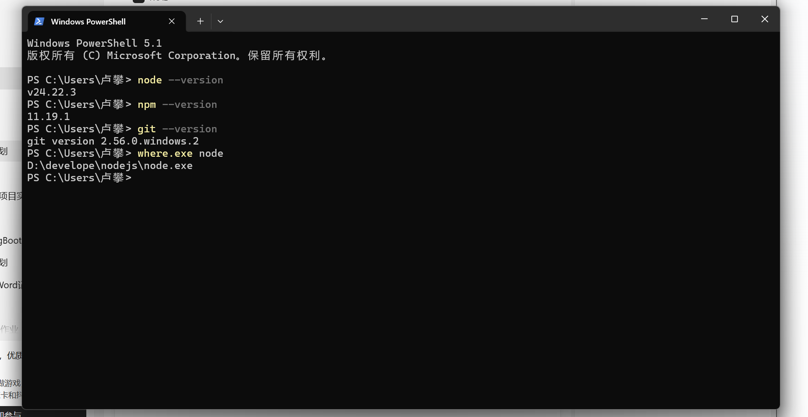
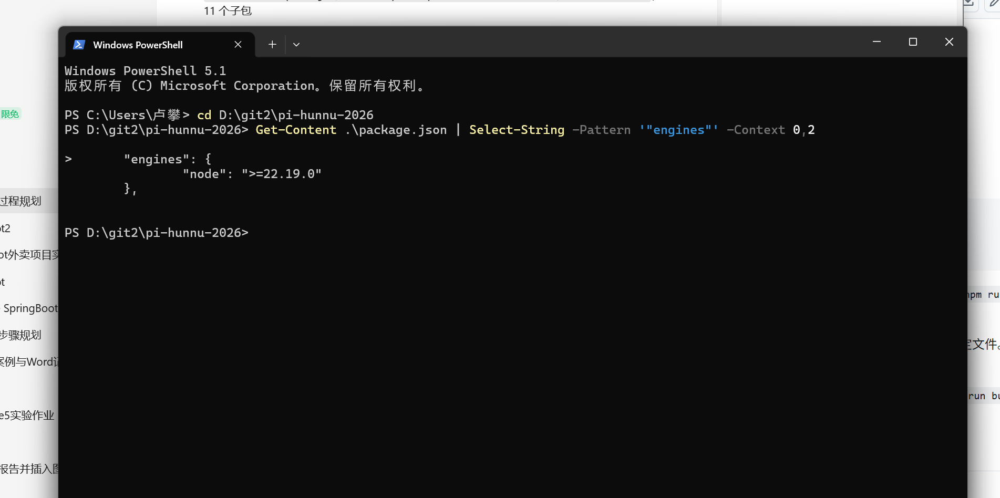
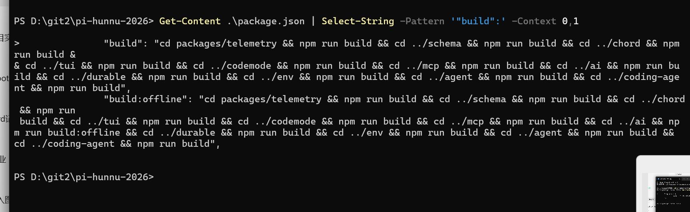
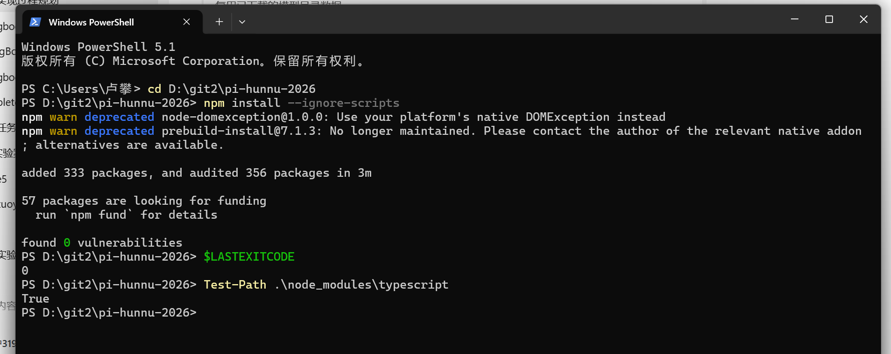
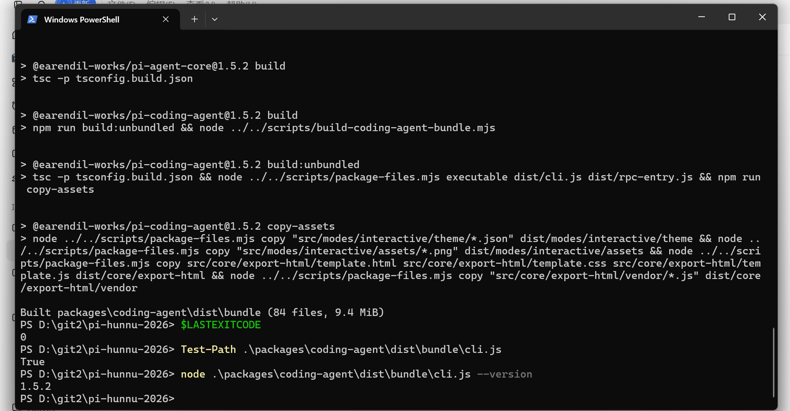
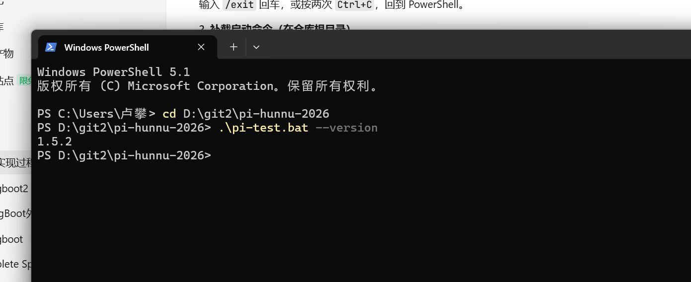
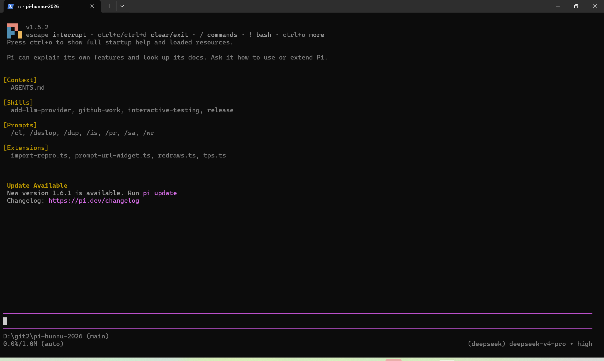
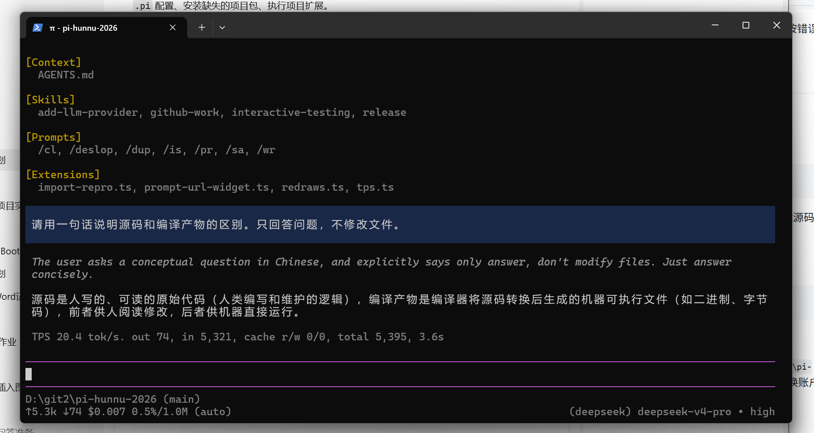

# 实践课3：Pi Agent 源码安装与编译 实验报告

| 项目 | 内容 |
|---|---|
| 姓名 / 学号 | 卢攀 / 202430224093 |
| 个人作业仓库 | https://github.com/xhxmdl/lupan-assignments.git |
| 小组仓库（fork） | https://github.com/applerere/pi-hunnu-2026.git |
| 本地路径 | `D:\git2\pi-hunnu-2026` |
| 分支 / 提交 | `main` / `c3cc91632d0a1950fb122605b190233f2aa0006e` |
| 实验环境 | Windows 10/11 x64、Windows PowerShell 5.1 |

## 一、环境依赖版本（任务一）

在 PowerShell 中依次执行，实际结果如下：

```
node --version   -> v24.22.3
npm --version    -> 11.19.1
git --version    -> git version 2.56.0.windows.2
where.exe node   -> D:\develope\nodejs\node.exe
```



**安装与升级说明：** 机器原有 Node.js v22.23.4，虽然满足根 `package.json` 中 `engines.node >= 22.19.0` 的声明，但仓库中部分依赖（如 `@earendil-works/gondolin`）要求 Node.js `>= 23.6.0`，继续使用会在 `npm install` 阶段产生 `EBADENGINE` 警告。因此按课程建议改用 Node.js 24 LTS（v24.22.3）的 Windows x64 `.msi` 安装包覆盖安装，npm 随安装包一并提供，无需单独安装。

`node -e "console.log('Hello, Node.js!')"` 输出 `Hello, Node.js!`，说明运行时正常；`where.exe node` 只返回 `D:\develope\nodejs\node.exe` 一行，说明 PATH 中没有残留的旧版本，不存在多版本混用。

## 二、源码获取（任务二）

按教师要求，本任务沿用第二次实践课已克隆的小组 fork 仓库，本次不再重复截图。为便于后续说明，记录仓库状态如下：

| 检查项 | 结果 |
|---|---|
| 当前目录 | `D:\git2\pi-hunnu-2026` |
| origin | `https://github.com/applerere/pi-hunnu-2026.git` |
| 当前分支 | `main` |
| 完整提交号 | `c3cc91632d0a1950fb122605b190233f2aa0006e` |
| 工作区状态 | 干净，无未提交改动 |

经与教师仓库 `main` 的最新提交比对，本地 HEAD 与上游完全一致（同一 SHA），说明本地源码就是课程要求的那一版，后续安装和构建均基于该提交。

## 三、安装与编译依据（任务三）

在仓库根目录读取 `package.json`，确认两个关键配置。

**1. Node.js 版本要求的来源**



**2. 构建命令的来源**



**回答：Node.js 版本要求写在哪里？**
写在仓库根目录 `package.json` 的 `engines.node` 字段中，值为 `>=22.19.0`。它约束的是整个 monorepo，而不是某个子包；各子包（如 `packages/coding-agent/package.json`）另有自己的 `engines` 声明，个别第三方依赖的要求还可能更严格，因此实际环境版本应取所有约束中最高者。

**回答：`npm run build` 实际从哪里读取命令？**
读根 `package.json` 的 `scripts.build`。该字段是一条以 `cd` 和 `&&` 串联的长命令，依次进入 `telemetry → schema → chord → tui → codemode → mcp → ai → durable → env → agent → coding-agent` 共 11 个子包，执行各包自己的 `npm run build`（`tsc` 编译与打包脚本）。`&&` 表示前一步成功才继续，任何一步失败都会中断后续。npm 本身不具备通用编译能力，编译内容完全由这条脚本决定。

此外，仓库使用 npm workspaces 管理多个包，因此依赖只需在根目录安装一次，不能给每个子包单独创建锁文件。

## 四、安装依赖（任务四）

在仓库根目录执行：

```powershell
npm install --ignore-scripts
```



关键输出与判定：

- `added 333 packages, audited 356 packages in 3m`：依赖安装完成
- `found 0 vulnerabilities`：本次审计未报告已知漏洞
- `$LASTEXITCODE` = `0`：命令成功结束
- `Test-Path .\node_modules\typescript` = `True`：依赖确实落到本地目录

**命令作用说明：**

| 行为 | 说明 |
|---|---|
| 解析并下载依赖 | 依据 `package.json` 声明与 `package-lock.json` 锁定版本解析依赖，锁文件一致时使用锁定版本，保证可复现 |
| 建立依赖目录 | 在仓库根生成 `node_modules`，并按 workspaces 关联仓库内的本地子包 |
| 安装开发工具 | 包括 `typescript`、`esbuild`、`@biomejs/biome` 等编译器与打包器 |
| `--ignore-scripts` | 跳过安装阶段自动触发的生命周期脚本（如 `postinstall`、根目录的 `prepare: husky`），不影响之后手动执行 `npm run build` |

该命令没有使用 `-g`，安装的是项目本地依赖，不会把修改后的 Pi 安装成全局 `pi` 命令，也不会覆盖第一次实践课安装的全局版本。

**警告与错误的区分：** 本次输出中的两类提示均属弃用警告，不是失败原因——`deprecated node-domexception@1.0.0`（建议改用平台原生 `DOMException`）、`deprecated prebuild-install@7.1.3`（该包不再维护）。命令最终退出码为 0，说明不存在导致失败的错误。`found 0 vulnerabilities` 只表示本次审计未发现已知漏洞，不能作为构建成功的依据；也没有执行 `npm audit fix --force`，以免改动课程锁定的依赖版本。

## 五、本地编译与产物验证（任务五）

在仓库根目录执行首次构建：

```powershell
npm run build
```



日志显示构建按脚本顺序逐个进入子包，末尾完成了 `packages/coding-agent` 的 `build:unbundled` 与 `copy-assets`，最终输出：

```
Built packages/coding-agent/dist/bundle (84 files, 9.4 MiB)
```

验证结果：

| 检查项 | 结果 |
|---|---|
| `$LASTEXITCODE` | `0` |
| `Test-Path .\packages\coding-agent\dist\bundle\cli.js` | `True` |
| `node .\packages\coding-agent\dist\bundle\cli.js --version` | `1.5.2` |

产物规模为 84 个文件、9.4 MiB；版本号 `1.5.2` 与 `packages/coding-agent/package.json` 中的版本一致，说明构建产物与当前源码对应。`dist` 目录存放构建结果，以后修改代码应改 `src` 下的源码并重新构建，直接改 `dist` 会在下次构建时被覆盖。

**关于首次构建联网：** 首次执行 `npm run build` 时，`packages/ai` 需要联网获取模型目录等配置数据（不是下载模型权重）。构建成功且该数据有效后，可用 `npm run build:offline` 重新编译，它只复用已下载的模型目录数据，不联网；但首次安装与首次数据初始化不能用它替代。

## 六、运行本地源码版本并完成一次会话（任务六）

**1. 验证源码入口**

```powershell
.\pi-test.bat --version
```



输出 `1.5.2`，与构建产物版本一致。该脚本名称虽含 `test`，但它是运行本地源码的入口，不执行测试套件：`pi-test.bat` 调用 `pi-test.ps1`，由 Node.js 加载源码解析器直接运行 `packages/coding-agent/src/cli.ts`，不读取 `dist`。

**2. 启动交互界面**

```powershell
.\pi-test.bat
```



界面顶部显示 `v1.5.2`，并加载了仓库内的 `[Context] AGENTS.md`、`[Skills]`、`[Prompts]`、`[Extensions]`，说明它读取的是当前仓库的配置与扩展，确实是本地源码在运行。首次启动时出现过 `Trust project folder?` 提示，选择 `Trust` 允许 Pi 加载项目设置、安装缺失的项目包并执行项目扩展。

界面中出现了 `Update Available: New version 1.6.1 is available. Run pi update` 提示，本次**未执行** `pi update`：该命令更新的是全局安装的 `pi`，与本地源码 1.5.2 无关，执行后会造成全局版本与本地源码版本并存、难以说明正在运行哪一个。

**3. 完成一次会话**

提示词与回复：



- 使用的提示词：`请用一句话说明源码和编译产物的区别。只回答问题，不修改文件。`
- 模型回复：源码是人写的、可读的原始代码（人类编写和维护的逻辑），编译产物是编译器将源码转换后生成的机器可执行文件（如二进制、字节码），前者供人阅读修改，后者供机器直接运行。
- 状态栏显示当前目录 `D:\git2\pi-hunnu-2026 (main)` 与模型 `deepseek-v4-pro`，确认是在本地仓库目录下、通过本地源码版本完成的一次真实模型调用（输出速率约 20.4 tok/s）。

本地源码版与已安装的 Pi 共用用户配置目录 `~/.pi/agent`，因此第一次实践课已完成登录的凭据会被复用，无需重新 `/login`；这属于复用用户配置，并不代表运行的是全局安装版本。

**回答：本次如何确保运行的是本地源码？**
使用 `.\pi-test.bat` 启动，而不是直接输入 `pi`。前者由 Node 加载 TS 源码解析器执行 `packages/coding-agent/src/cli.ts`，与 `dist/bundle/cli.js` 是两条独立入口；同时用 `.\pi-test.bat --version`、`node dist/bundle/cli.js --version` 与界面顶部版本三处比对，均为 `1.5.2`，可证明源码、产物与运行版本三者一致。若直接执行 `pi`，可能启动第一次实践课安装的全局版本，无法单独证明运行的是本地源码。

**回答：源码入口与 `dist/bundle/cli.js` 入口分别适合什么场景？**
源码入口适合开发调试：修改 `src` 后无需重新构建即可生效，便于快速迭代。`dist/bundle/cli.js` 适合验证构建结果与日常使用：它是打包后的单文件，依赖已内联，启动更快，最接近发布形态。

## 七、遇到的问题与解决过程（重点）

| # | 现象 | 原因分析 | 解决方式 | 佐证 |
|---|---|---|---|---|
| 1 | 原环境 Node.js 为 v22.23.4，不满足部分依赖声明的 `>=23.6.0` | 根 `package.json` 的 `>=22.19.0` 只是最低要求，实际安装时个别依赖要求更高 | 升级到 Node.js 24 LTS（v24.22.3），并用 `where.exe node` 确认 PATH 中只有一个 node | 图1 |
| 2 | `git fetch origin` 报 `Recv failure: Connection was reset` | 本机访问 GitHub 网络不稳定，需要代理 | 通过 GitHub API 核对上游 `main` 的最新提交，与本地 HEAD 同为 `c3cc9163`，确认无需拉取即可继续实验 | 第二节仓库状态表 |
| 3 | 安装输出中出现 `deprecated node-domexception`、`deprecated prebuild-install` | 上游依赖已弃用，属于提示信息 | 判定为警告而非错误：命令退出码为 0，未执行 `npm audit fix --force` | 图4 |
| 4 | 首次构建耗时较长，且 `packages/ai` 阶段需要联网 | 首次构建要获取模型目录等配置数据，并依次编译 11 个子包 | 保持网络与终端不中断，完整跑完；确认 `Built ... (84 files, 9.4 MiB)` 且退出码为 0 | 图5 |
| 5 | 执行 `.\pi-test.bat --version` 报 `ObjectNotFound`，提示"无法将 .\pi-test.bat 项识别为 cmdlet..." | 当时位于用户主目录 `C:\Users\卢攀`，不在仓库根目录，`.\` 只查找当前目录 | `cd D:\git2\pi-hunnu-2026` 后重新执行，成功输出 `1.5.2` | 图6 |
| 6 | 首次启动 Pi 弹出 `Trust project folder?` | 首次在该目录运行，需要授权加载 `.pi` 配置并执行项目扩展 | 选择 `Trust` 持久信任该仓库，之后不再提示 | 图7 |
| 7 | 界面提示可升级到 1.6.1 | 全局安装的 `pi` 检测到 npm 上有新版本 | 未执行 `pi update`，避免全局版本与本地源码版本混淆 | 图7 |

补充经验：`.\` 前缀表示"当前目录下的文件"，而不带路径的命令只会去 PATH 中查找；这是排查"命令找不到"类问题最快的切入点。

## 八、实验总结

| 作业要求的说明项 | 结论 |
|---|---|
| 源码在哪里 | `D:\git2\pi-hunnu-2026`，分支 `main`，提交 `c3cc91632d0a1950fb122605b190233f2aa0006e` |
| 依赖装在哪里 | 仓库根目录的 `node_modules`，通过 npm workspaces 与 `packages/*`、`apps/*` 中的本地子包关联 |
| 构建执行了什么 | 根 `scripts.build` 依次进入 11 个子包执行各自的 `npm run build`，由 `tsc` 编译并以 `esbuild` 打包，最终生成 `packages/coding-agent/dist/bundle`（84 个文件，9.4 MiB） |
| 正在运行哪个版本 | `1.5.2`，源码入口、构建产物、界面顶部三处一致 |

通过本次实践，建立起了本地源码开发环境：源码由 Git 管理并锁定到具体提交，依赖由 npm 依据锁文件安装在根目录，构建由根脚本按顺序驱动各子包完成，运行时可任选源码入口（调试）或打包产物（验证与使用）。同时明确了本文档强调的两个区别——源码（`src`）是修改对象，构建产物（`dist`）是生成结果；本地构建与模型推理服务是两件事，本次不涉及模型权重。

## 九、提交信息

- 报告与截图已上传至个人 Git 仓库
- 课程作业仓库提交 Issue，标题：`实践课3：Pi Agent源码安装与编译 lupan`
