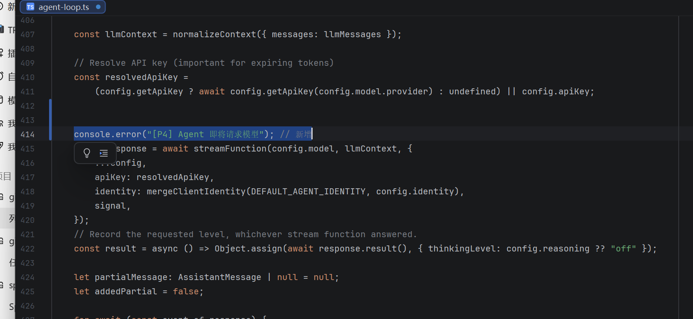
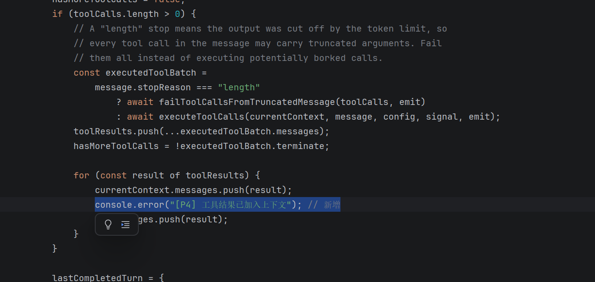
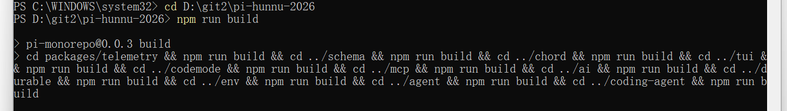
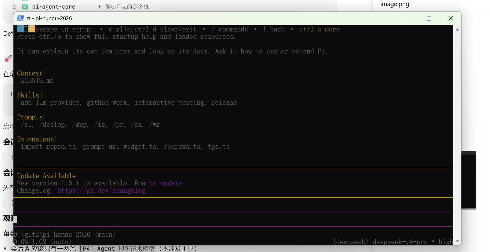
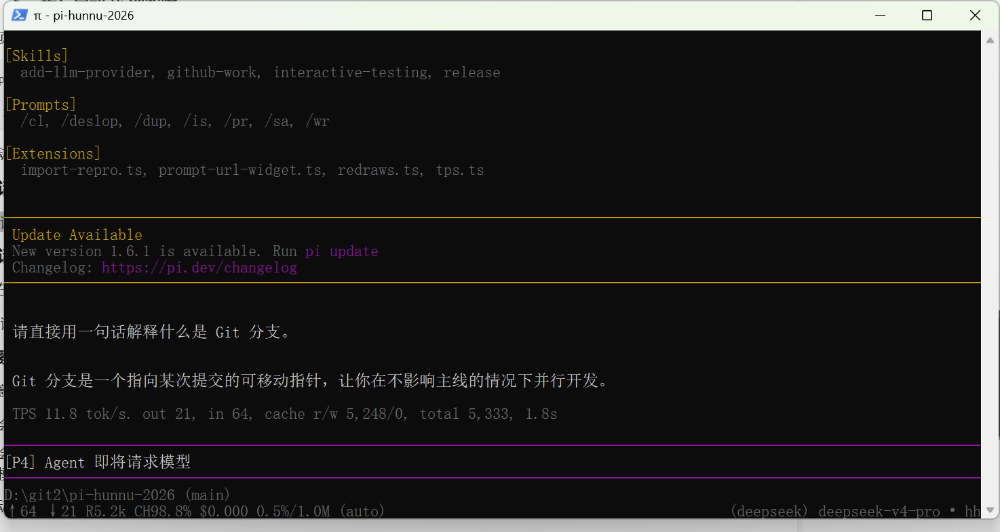
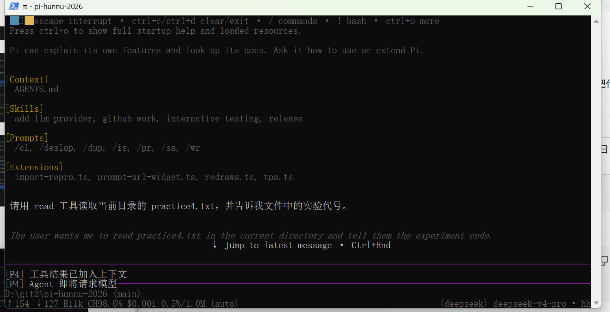

# 实践课4：Pi Agent 模型调用与运行流程 实验报告

| 项目 | 内容 |
|---|---|
| 姓名 / 学号 | 卢攀 / 202430224093 |
| 个人作业仓库 | https://github.com/xhxmdl/lupan-assignments.git |
| 小组仓库（fork） | https://github.com/applerere/pi-hunnu-2026.git |
| 本地路径 | `D:\git2\pi-hunnu-2026` |
| 实验环境 | Windows 11 x64、Windows PowerShell 5.1、Node.js v24.22.3 |
| 使用模型 | deepseek-v4-pro |

---

## 一、源码修改（任务一）

在 `packages/agent/src/agent-loop.ts` 中插入两处日志。

### 1. 模型调用前（约原第 412 行）

在 `const response = await streamFunction(...)` **上方**插入一行：

```ts
console.error("[P4] Agent 即将请求模型"); // 新增
const response = await streamFunction(config.model, llmContext, {
    ...config,
    apikey: resolvedApiKey,
    identity: mergeClientIdentity(DEFAULT_AGENT_IDENTITY, config.identity),
    signal,
});
```

截图 S1：编辑器中 agent-loop.ts，新增日志位于第 414 行，紧接下方 `await streamFunction(...)`。



### 2. 工具结果加入上下文后（约原第 284 行）

在 `currentContext.messages.push(result);` **下方**、`newMessages.push(result);` **上方**插入一行（位于 `for` 循环体内，每写入一条工具结果打印一次）：

```ts
for (const result of toolResults) {
    currentContext.messages.push(result);
    console.error("[P4] 工具结果已加入上下文"); // 新增
    newMessages.push(result);
}
```

截图 S2：for 循环内，`push(result)` 与新增日志紧邻。



---

## 二、重新编译与启动（任务二）

### 编译过程

在项目根目录 `D:\git2\pi-hunnu-2026` 执行 `npm run build`。由于机器启用了 Windows Defender 实时防护，TypeScript 编译器（tsc）在并行写入 `.js` 和 `.js.map` 文件时会被短暂锁定，导致 `Access is denied` 错误。临时关闭 Defender 后编译顺利通过。




关键输出：

- 依次构建 11 个包：telemetry → schema → chord → tui → codemode → mcp → ai → durable → env → agent → coding-agent
- `Built packages/coding-agent/dist/bundle (84 files, 9.4 MiB)`：coding-agent 打包成功
- `$LASTEXITCODE` = `0`：整体构建无错误

### 启动 Pi

```powershell
node .\packages\coding-agent\dist\cli.js
```



---

## 三、两次运行对比（任务三）

在项目根目录创建 `practice4.txt`，写入实验代号 `P4-TEST-20261126`。使用同一模型（deepseek-v4-pro），分别在两个新会话中测试。

### 会话 A：直接问答（不涉及工具）

**输入指令：**
> 请直接用一句话解释什么是 Git 分支。

**实际出现的 `[P4]` 日志：**

```
[P4] Agent 即将请求模型
```

共 **1 条**，没有出现"工具结果已加入上下文"，说明没有执行任何工具。

**Pi 最终回复：**
> Git 分支是一个指向某次提交的可移动指针，让你在不影响主线的情况下并行开发。

**分析：**

| 观察项 | 结果 |
|---|---|
| 是否调用工具 | ❌ 未调用 |
| 模型调用轮数 | **1 轮** |
| 日志条数 | 1 条 Agent 即将请求模型 |

模型一次调用直接返回答案，不需要工具辅助。



### 会话 B：读取文件（涉及工具调用）

**输入指令：**
> 请用 read 工具读取当前目录的 practice4.txt，并告诉我文件中的实验代号。

**实际出现的 `[P4]` 日志（按顺序）：**

```
[P4] 工具结果已加入上下文       ← read 结果被写入 messages
[P4] Agent 即将请求模型        ← 带着工具结果发起第 2 次模型请求
```

补充：在会话最上方（滚屏后被遮住）还有一条 `[P4] Agent 即将请求模型`，对应第 1 轮模型调用。完整顺序：

```
[P4] Agent 即将请求模型        ← 第 1 轮：模型决定调用 read 工具
[P4] 工具结果已加入上下文       ← read 执行完毕，结果 push 到 messages
[P4] Agent 即将请求模型        ← 第 2 轮：带着文件内容再次请求模型
```

**Pi 最终回复：**
> （读取 practice4.txt 成功，返回文件中的实验代号）

**分析：**

| 观察项 | 结果 |
|---|---|
| 是否调用工具 | ✅ 调用了 read |
| 模型调用轮数 | **2 轮** |
| 日志条数 | 2 条 Agent 即将请求模型 + 1 条工具结果已加入上下文 |



---

## 四、运行流程分析

### 4.1 谁实际读了文件？

**Agent 框架读了文件，不是模型。**

运行链路如下：

1. **第 1 轮模型调用**：模型根据用户指令，返回一条 `tool_call`，告知 Agent 它想调用 `read("practice4.txt")`
2. **Agent 框架执行工具**：`agent-loop.ts` 检测到模型返回了 `toolCalls`，遍历调用 `executeToolCalls(...)`，真正去读取磁盘上的 `practice4.txt`，得到文件内容
3. **写回上下文**：`for (const result of toolResults) { currentContext.messages.push(result) }` 把工具执行结果（含文件内容）作为一条新的 message 加入对话历史
4. **第 2 轮模型调用**：把更新后的 `currentContext.messages`（现在包含用户指令 + 模型的 tool_call + read 返回结果）整体发给模型，模型看到文件内容后直接回答

模型本身**不具备直接访问文件系统的能力**，它只能通过返回 `tool_call` 来"请求"Agent 代为执行。真正的文件 I/O 由 Agent 的工具执行层完成。

### 4.2 下一轮模型请求多带了什么？

下一轮请求的 messages 列表**比上一轮多了两条消息**：

1. **assistant message**：模型在第 1 轮返回的 tool_call，如 `{"role":"assistant","content":null,"tool_calls":[{"id":"...","function":{"name":"read","arguments":"{\"file_path\":\"practice4.txt\"}"}}]}`
2. **tool result message**：read 工具执行后的返回值，如 `{"role":"tool","tool_call_id":"...","content":"P4-TEST-20261126"}`

这两条新消息插入后，完整的对话历史变成：

```
[用户原始指令]          ← 原有
[模型 tool_call]        ← 新增
[read 工具返回结果]      ← 新增
```

模型在第 2 轮请求时就能"看到"上一轮自己的 tool_call 和工具实际返回的内容，因此可以基于真实文件内容给出最终回答。

### 4.3 调用链路简图

```
┌─────────────────┐    ┌─────────────────┐    ┌─────────┐    ┌──────────────────┐
│ coding-agent    │───▶│ agent-loop.ts    │───▶│ pi-ai   │───▶│ 远程模型服务      │
│ (cli.js 入口)   │    │ (Agent 主循环)   │    │ (LLM 包) │    │ (deepseek-v4-pro) │
└─────────────────┘    └────────┬────────┘    └─────────┘    └──────────────────┘
                                 │
                                 │ ① 发起模型请求
                                 ▼
                          ┌─────────────┐
                          │ ② 模型返回    │
                          │   tool_call  │
                          └──────┬──────┘
                                 │
                                 ▼
                          ┌─────────────┐
                          │ ③ Agent 执行 │
                          │   read 工具  │
                          └──────┬──────┘
                                 │
                                 ▼
                          ┌─────────────┐
                          │ ④ 结果 push  │
                          │   回 messages│
                          └──────┬──────┘
                                 │
                                 ▼
                          ┌─────────────┐
                          │ ⑤ 再次请求   │
                          │   模型回答   │
                          └─────────────┘
```

各模块职责：

| 模块 | 职责 |
|---|---|
| coding-agent | CLI 入口，初始化配置，启动交互循环 |
| agent-loop.ts | Agent 主循环，负责维护消息上下文、调度模型调用、执行工具、把工具结果写回 messages |
| pi-ai | 封装 LLM SDK，把 Agent 的 messages 转成模型 API 格式，发 HTTPS 请求 |
| 远程模型服务 | 接收 prompt，生成回复（可能包含 tool_call），返回给 Agent |

---

## 五、两次会话对比总结

| 对比项 | 会话 A（直接问答） | 会话 B（读取文件） |
|---|---|---|
| 用户指令 | 解释 Git 分支 | read practice4.txt 告诉我代号 |
| 工具调用 | ❌ 无 | ✅ read |
| 模型轮数 | 1 轮 | 2 轮 |
| [P4] 日志条数 | 1 条 | 3 条（2 条即将请求模型 + 1 条工具结果） |
| 第 1 轮模型 | 直接生成自然语言答案 | 返回 tool_call: read("practice4.txt") |
| 中间动作 | — | Agent 执行 read → push 结果到 messages |
| 第 2 轮模型 | — | 基于文件内容生成最终答案 |

**本质区别：** 会话 B 在两轮模型调用之间多了一个 **工具执行 → 结果回写** 的环节。`agent-loop.ts` 正是通过 for 循环中的 `currentContext.messages.push(result)` 把这个环节与下一轮模型请求串联起来，使"工具结果"自动成为下一轮 prompt 的一部分。这就是 Agent 能够"先看再答"的核心机制。
